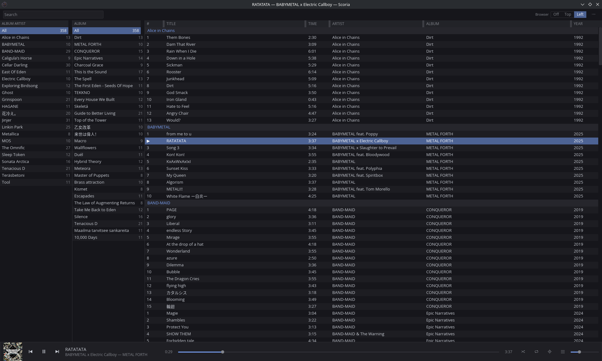
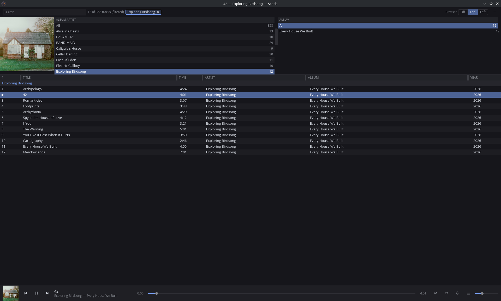

# Scoria

A library-centric music player for Linux, in Rust.

Most players are playlist-centric and treat the library as a source to build
playlists from. Scoria inverts that: the library is the primary object, and you
navigate it directly. Opinionated defaults, dense information display, minimal
configuration.

It is aimed at someone with a well-organised local library who listens to whole
albums and wants to see a lot of information at once.

> **Status: 1.0.** Scanning and watching, three layouts, gapless playback,
> shuffle and repeat, ReplayGain, artwork, the queue, search and filtering,
> settings, and the desktop's media keys. Playlists, tag editing, vim bindings
> and a ratatui frontend are deliberately post-1.0; [`DESIGN.md`](DESIGN.md)
> says why for each.

<!-- Screenshots go here. Drop the files in docs/ and uncomment:



|  |  |
|---|---|
|  |  |

Worth showing: the Left layout with both filter panes populated and a track
playing, so the artwork and transport are not empty; the Top layout, because it
is the one that looks least like other players; and the track menu open, since
it is the main mouse path added late.
-->

## What it does

- **Browses a library, not a playlist.** Filter panes cascade album artist to
  album to tracks; the table is the same table in all three layouts.
- **Playback is a snapshot.** What plays is a materialised list of tracks.
  Re-sorting, filtering or searching never disturbs it.
- **Gapless.** The next track is decoded before the current one drains, so
  albums that were mastered to run together do.
- **ReplayGain**, read from tags -- album gain in album order, track gain when
  shuffled. Never computed, never guessed; untagged tracks play at 0 dB.
- **Watches the library.** Files added or removed are picked up without asking,
  and an explicit rescan is always available.
- **Media keys**, `playerctl`, and whatever your desktop shows in its own panel,
  over MPRIS -- from the graphical player and from `scoria play` alike.
- **Mouse first, keyboard fast.** Everything reachable by a keybinding is
  reachable without one. `?` lists the bindings, generated from the keymap so it
  cannot drift.

## Formats

FLAC, MP3, Ogg Vorbis, AAC and Apple Lossless in MP4, raw AAC, WAV and AIFF.

Everything the scanner indexes can be played, and the test suite enforces it:
there is a decoding fixture for every extension the library accepts, so a format
cannot be listed without a decoder behind it. **Opus is not supported** --
Symphonia has no Opus decoder -- and neither are WavPack, Monkey's Audio,
Musepack or WMA. Files in those formats are not indexed rather than indexed and
silently unplayable.

## Design

[`DESIGN.md`](DESIGN.md) is the authority on what is being built and why, down to
the decisions that were deliberately *not* taken. Some highlights:

- **Three layouts, one implementation.** They differ by where the browser sits and
  nothing else. There are no dockable panes, no splitters, and no layout files --
  not in 1.0, not later.
- **Playback is a snapshot.** What plays is a materialised, ordered list of track
  ids. Browsing, filtering and re-sorting never disturb it.
- **Album artist is structural; artist is display.** Filter panes, grouping and
  sorting always use `albumartist`; `artist` is only ever rendered in a column.
- **Configuration tunes defaults; it never constructs the application.** The app is
  fully usable by someone who never opens settings.

The library is assumed to be tagged with [MusicBrainz Picard](https://picard.musicbrainz.org/).
That assumption is load-bearing: sorting on `albumartistsort` is what makes
`The Omnific` sort as `Omnific, The` and `花冷え。` as `HANABIE.` without any
special-case code.

## Building

Requires Rust 1.89 or newer and the ALSA development headers:

```sh
# Debian/Ubuntu
sudo apt install libasound2-dev
# Fedora
sudo dnf install alsa-lib-devel
# Arch
sudo pacman -S alsa-lib
```

Then, with [`just`](https://github.com/casey/just):

```sh
just build
just test
just check    # the full gate CI runs: fmt, clippy, tests, invariants
just          # list every recipe
```

Or with cargo directly:

```sh
cargo build --workspace
cargo test --workspace
./scripts/check-boundaries.sh   # architectural invariants CI also enforces
```

## No network

Scoria does not talk to the internet -- not for artwork, tags, lookups, updates
or telemetry. It reads the library on disk and nothing else, and that is a
decision about what the application is rather than a privacy feature bolted on.
The build enforces it: `scripts/check-boundaries.sh` fails if an HTTP or TLS
client appears anywhere in the dependency graph.

## No-panic policy

The application is written to have no known way to panic at runtime. `unwrap`,
`expect`, `panic!`, direct indexing and slicing, and `unsafe` are denied
workspace-wide rather than discouraged, and `scripts/check-boundaries.sh` flags
any local `allow` that reopens one outside a test module. Errors are returned and
surfaced through the event stream instead.

## Installing

```sh
just install          # the binary into ~/.cargo/bin, plus the desktop entry
just desktop-install  # only the desktop entry and icon
just uninstall        # both, leaving settings and the database alone
```

Everything goes under your home directory; nothing is written system-wide. The
desktop entry is what gives the running window its icon and puts Scoria in the
application menu.

## Trying it

`scoria` with no arguments opens the player. The first run asks for your music
folder.

The same binary drives the library from the terminal:

```sh
scoria scan ~/Music
scoria artists
scoria play "sleep token"
```

`scoria help` lists the rest. The command line drives the same `Command`/`Event`
seam the graphical frontend will, which is what keeps that seam honest -- and it
exists first, so there is no way for UI code to reach past it.

## Layout

| Crate | Role |
|---|---|
| `scoria-core` | Library index, scanner, query engine, playback engine. Depends on no UI crate. |
| `scoria-gui` | iced frontend. |
| `scoria-bin` | The `scoria` binary: picks a frontend, and drives the core directly for debugging. The only crate that builds an executable. |

`scoria-core` talks to frontends by receiving `Command` and emitting `Event`, both
serialisable. The frontend never calls into core internals. This is enforced by
the dependency graph and by `scripts/check-boundaries.sh`, not by convention.

A `scoria-tui` (ratatui) frontend is planned post-1.0; the seam is what makes it
cheap.

## Licence

GPL-3.0-only. See [LICENSE](LICENSE).
